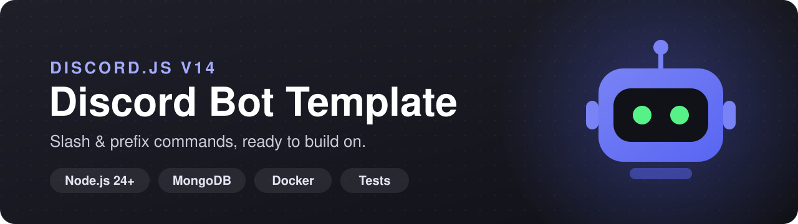
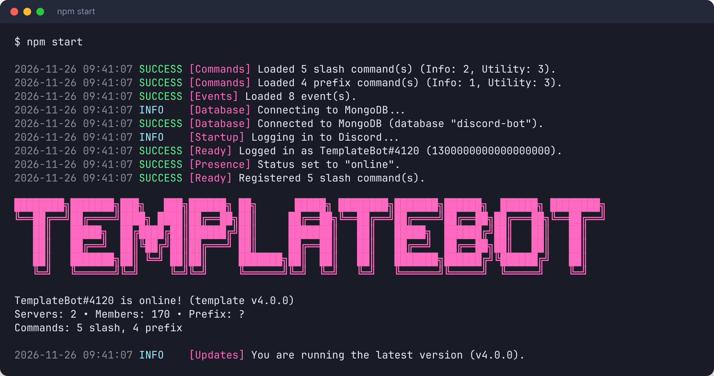

<p align="center">
  
</p>

<p align="center">
  <a href="https://github.com/Kkkermit/DiscordBotV14-template/actions/workflows/ci.yml"></a>
  <a href="https://github.com/Kkkermit/DiscordBotV14-template/actions/workflows/codeql.yml"></a>
  <a href="https://github.com/Kkkermit/DiscordBotV14-template/releases"></a>
  <a href="LICENSE"></a>
  <br>
  <a href="https://discord.js.org"></a>
  <a href="https://nodejs.org"></a>
  <a href="https://prettier.io"></a>
  <a href="https://discord.gg/xcMVwAVjSD"></a>
</p>

<h1 align="center">Discord Bot Template for discord.js v14</h1>

<p align="center">
  <b>A clean, beginner-friendly Discord bot template and boilerplate for Node.js.</b><br>
  Slash commands, prefix commands, events, MongoDB and Docker, ready to go. Add a file, restart, and your<br>
  command is live. Loading, validation, cooldowns, permissions, error handling and logging are taken care of.
</p>

<p align="center">
  <a href="docs/getting-started.md">Getting started</a> •
  <a href="docs/commands.md">Writing commands</a> •
  <a href="docs/configuration.md">Configuration</a> •
  <a href="docs/deployment.md">Deployment</a> •
  <a href="docs/troubleshooting.md">Troubleshooting</a>
</p>

---

## Contents

- [Features](#features)
- [Quick start](#quick-start)
- [What you get](#what-you-get)
- [Adding a command](#adding-a-command)
- [Project structure](#project-structure)
- [Scripts](#scripts)
- [Configuration](#configuration)
- [Development workflow](#development-workflow)
- [Documentation](#documentation)
- [Upgrading from v3](#upgrading-from-v3)
- [Contributing and support](#contributing-and-support)

## Features

- **Slash and prefix commands** side by side, organised in category folders and loaded automatically.
- **Working examples** of autocomplete (`/help`), buttons (`bot-info`), options (`/user-info`) and embeds.
- **Command options built in**: per-user cooldowns, developer-only commands, required permissions and arguments.
- **Commands register themselves**: every slash command is registered with Discord when the bot starts, so adding
  a file and restarting is all it takes.
- **Clear errors instead of crashes**: a wrong `.env` value, a config typo or a broken command file is explained
  in the console. Users see a friendly message, never your stack trace.
- **Your bot's name in ASCII art** on startup, drawn with [figlet](https://github.com/patorjk/figlet.js).
- **Optional MongoDB** with Mongoose. Leave the connection string empty and the bot runs without a database.
- **Production ready**: graceful shutdown, minimal gateway intents, safe mention defaults, Docker and Compose.
- **Modern, simple tooling**: Node.js 24+, ESLint, Prettier on every commit, tests with the built-in Node.js
  test runner, GitHub Actions for CI, releases and CodeQL, and Dependabot. It's plain JavaScript:
  no TypeScript and no build step.

## Quick start

You need [Node.js 24 or newer](https://nodejs.org/) and a bot application on the
[Discord Developer Portal](https://discord.com/developers/applications)
([step-by-step guide](docs/getting-started.md#1-create-your-discord-bot)).

```bash
# 1. Get the code (or click "Use this template" on GitHub)
git clone https://github.com/Kkkermit/DiscordBotV14-template.git my-bot
cd my-bot

# 2. Install the dependencies
npm install

# 3. Create your .env file. It asks for your token and checks every answer.
npm run setup
```

4. In the Developer Portal, turn on **Message Content Intent** under **Bot → Privileged Gateway Intents**.
   Without it the bot can't log in.
5. [Invite the bot](docs/getting-started.md#3-invite-the-bot-to-your-server) to your server.
6. Run `npm start` and try `/help` or `?help` in your server.

> [!TIP]
> Don't see a new slash command yet? Press `Ctrl+R` (`Cmd+R` on macOS) in Discord to refresh it.

## What you get

When the bot starts, it checks your settings, loads every command and event, and greets you with its name:

<p align="center">
  
</p>

These commands are included, ready to change or delete:

| Slash command | Prefix command                      | What it does                                       |
| ------------- | ----------------------------------- | -------------------------------------------------- |
| `/help`       | `?help [command]` (`h`, `commands`) | Lists the commands, or shows details about one.    |
| `/ping`       | `?ping` (`latency`)                 | Shows the round trip and WebSocket latency.        |
| `/uptime`     | `?uptime` (`botuptime`)             | Shows how long the bot has been online.            |
| `/bot-info`   | `?bot-info` (`bi`, `botinfo`)       | Bot statistics, with a refresh button.             |
| `/user-info`  |                                     | Information about a user and their server profile. |

The bot also introduces itself when a message only mentions it, and `@YourBot ping` works as a prefix too.

## Adding a command

Create a file in a category folder, for example `src/commands/slash/fun/hello.js`:

```js
// src/commands/slash/fun/hello.js
const { SlashCommandBuilder } = require('discord.js');

module.exports = {
  data: new SlashCommandBuilder().setName('hello').setDescription('Say hello!'),
  cooldown: 5, // Optional, in seconds.

  async execute(interaction, client) {
    await interaction.reply(`Hello ${interaction.user}, I'm ${client.user.username}!`);
  },
};
```

Restart the bot and `/hello` is ready, listed in `/help` under **Fun**. Prefix commands work the same way in
`src/commands/prefix/`. [Writing commands](docs/commands.md) covers options, autocomplete, buttons, permissions and
more.

## Project structure

```text
├── .github/                   CI, release and CodeQL workflows, issue templates, Dependabot
├── .husky/pre-commit          Formats your staged files with Prettier on every commit
├── docs/                      Guides (start with getting-started.md)
├── scripts/
│   └── setup-env.js           npm run setup: creates your .env file
├── src/
│   ├── commands/
│   │   ├── prefix/<category>/ Prefix commands, e.g. prefix/utility/ping.js
│   │   └── slash/<category>/  Slash commands, e.g. slash/utility/ping.js
│   ├── database/              MongoDB connection and Mongoose models
│   ├── events/<category>/     Event listeners, e.g. events/messages/messageCreate.js
│   ├── handlers/              Loads commands and events, handles shutdown
│   ├── lib/                   Helpers: logger, embeds, cooldowns, help, banner...
│   ├── client.js              The Discord client, with the template's helpers
│   ├── config.js              Your bot's settings
│   ├── env.js                 Loads and checks the .env file
│   └── index.js               Starts the bot
├── test/                      Tests, in the same folders as the code they test
├── .env.example               Every environment variable, explained
├── AGENTS.md                  The codebase explained for AI coding agents (and curious humans)
├── compose.yaml, Dockerfile   Run the bot with Docker
└── package.json
```

[Architecture](docs/architecture.md) explains how a message or interaction flows through the bot.

## Scripts

| Command                 | What it does                                                            |
| ----------------------- | ----------------------------------------------------------------------- |
| `npm start`             | Starts the bot.                                                         |
| `npm run dev`           | Starts the bot and restarts it when you change or add a file in `src/`. |
| `npm run setup`         | Creates your `.env` file step by step.                                  |
| `npm test`              | Runs the tests.                                                         |
| `npm run test:coverage` | Runs the tests and checks how much of the code they cover.              |
| `npm run lint`          | Checks the code with ESLint. `npm run lint:fix` fixes what it can.      |
| `npm run format`        | Formats every file with Prettier.                                       |
| `npm run check`         | Runs the linter, the format check and the tests, like CI does.          |

## Configuration

Secrets go in `.env` ([all variables](docs/configuration.md#environment-variables)):

| Variable        | Required | Description                                                          |
| --------------- | -------- | -------------------------------------------------------------------- |
| `DISCORD_TOKEN` | Yes      | Your bot token.                                                      |
| `DEVELOPER_IDS` | No       | Comma-separated user IDs allowed to use `developerOnly` commands.    |
| `MONGODB_URI`   | No       | MongoDB connection string. Leave it empty to run without a database. |
| `LOG_LEVEL`     | No       | `debug`, `info` (default), `warn` or `error`.                        |

Everything else is in [`src/config.js`](src/config.js): the prefix, embed colour, banner font, status and activities,
cooldowns, a command log channel, the replies users see, and the update check. Every setting is described in
[Configuration](docs/configuration.md#configjs), and mistakes are reported when the bot starts.

## Development workflow

- **Formatting is automatic.** `npm install` sets up a Git hook that runs ESLint and Prettier on the files you
  commit, so every commit is consistently formatted. With the recommended VS Code extensions, files are also
  formatted when you save.
- **Every push and pull request is checked** by GitHub Actions: linting, formatting, the tests on Node.js 24 and 26
  with a coverage gate, a Docker build and a CodeQL security scan.
- **Releases are one command.** `npm version minor && git push --follow-tags` creates a GitHub release with the notes
  from [`CHANGELOG.md`](CHANGELOG.md) and publishes a Docker image to the GitHub Container Registry. See
  [Deployment](docs/deployment.md#releasing-a-new-version).

## Documentation

| Guide                                      | What's in it                                                        |
| ------------------------------------------ | ------------------------------------------------------------------- |
| [Getting started](docs/getting-started.md) | Create the bot, invite it and run it for the first time.            |
| [Writing commands](docs/commands.md)       | Slash and prefix commands, options, autocomplete, buttons, helpers. |
| [Events](docs/events.md)                   | React to anything that happens on Discord, and gateway intents.     |
| [Configuration](docs/configuration.md)     | Every `.env` variable and `config.js` setting.                      |
| [Database](docs/database.md)               | Using MongoDB and Mongoose models.                                  |
| [Deployment](docs/deployment.md)           | Docker, PM2, hosting platforms and releases.                        |
| [Architecture](docs/architecture.md)       | How the template works under the hood, and how it's tested.         |
| [Troubleshooting](docs/troubleshooting.md) | Fixes for the most common problems.                                 |

## Upgrading from v3

Version 4 is a rewrite. The main changes are the new environment variable names, the `src/commands/slash` and
`src/commands/prefix` folders and the reorganised `config.js`. The [changelog](CHANGELOG.md#400) has a step-by-step
migration guide.

## Contributing and support

- ⭐ If this template helps you, please leave a star. It shows that people find the project useful!
- Questions? Join the [Discord server](https://discord.gg/xcMVwAVjSD).
- Found a bug or have an idea? [Open an issue](https://github.com/Kkkermit/DiscordBotV14-template/issues/new/choose).
- Want to help? Read the [contributing guide](CONTRIBUTING.md) and the [code of conduct](CODE_OF_CONDUCT.md).
- Security problem? Follow the [security policy](SECURITY.md) instead of opening an issue.

Released under the [MIT License](LICENSE).
