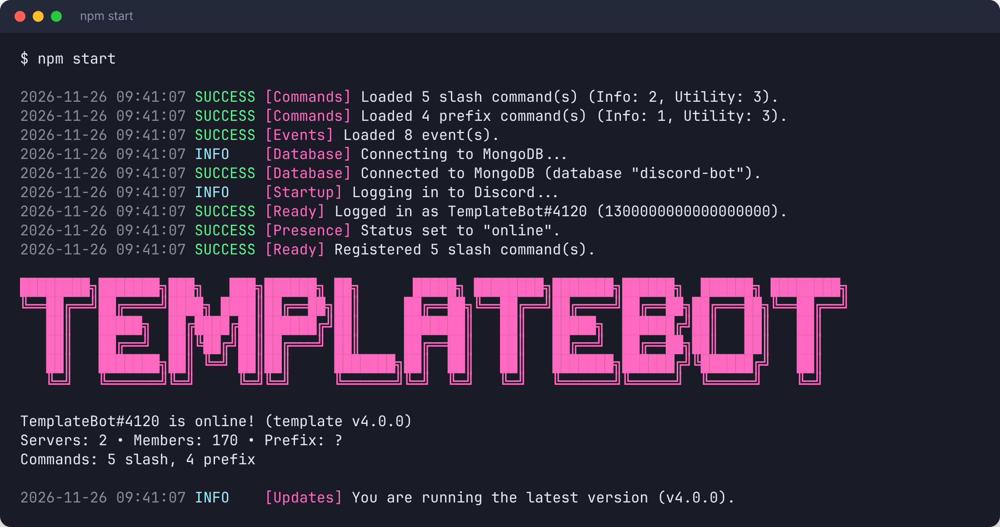

import { Card, CardGrid, LinkCard } from '@astrojs/starlight/components';

## Start the bot

In the project folder, run:

```bash
npm start
```

The console shows what the bot is doing. First it loads your commands and events, then it logs in:

```text frame="terminal" title="npm start" wrap
SUCCESS [Commands] Loaded 5 slash command(s) (Info: 2, Utility: 3).
SUCCESS [Commands] Loaded 4 prefix command(s) (Info: 1, Utility: 3).
SUCCESS [Events] Loaded 9 event(s).
INFO    [Startup] MONGODB_URI is not set, running without a database.
INFO    [Startup] Logging in to Discord...
SUCCESS [Ready] Logged in as MyBot#1234 (123456789012345678).
SUCCESS [Ready] Registered 5 slash command(s).
```

Then it prints your bot's name in big letters with a short summary. Your bot is online:



:::note
If the console shows an error instead, it says what's wrong and how to fix it. The most common problems are in
[Troubleshooting](../../help/troubleshooting/).
:::

## Try the commands

Go to your server and try a few. Type `/` to see the slash commands the bot added.

<CardGrid>
  <Card title="Slash commands" icon="forward-slash">
    `/help` lists every command. Also try `/ping`, `/uptime`, `/bot-info` and `/user-info`.
  </Card>
  <Card title="Prefix commands" icon="comment-alt">
    `?help`, `?ping`, `?uptime` and `?bot-info`. Mentioning the bot works as a prefix too: `@MyBot ping`.
  </Card>
</CardGrid>

:::tip[Slash commands not showing yet?]
Press <kbd>Ctrl</kbd> + <kbd>R</kbd> (<kbd>Cmd</kbd> + <kbd>R</kbd> on macOS) in the Discord app to reload it.
:::

## Restart automatically while you work

Stop the bot with <kbd>Ctrl</kbd> + <kbd>C</kbd>, then start it in development mode:

```bash
npm run dev
```

Now the bot restarts every time you save a file in `src/`, or add one. New commands show up a few seconds after you
save. Use `npm start` when you run the bot for real.

## You're set up

- [ ] The console says `Logged in as` your bot
- [ ] `/help` and `?help` reply in your server
- [ ] `npm run dev` restarts the bot when you save a file

Next, write your own commands, or add a database.

<CardGrid>
  <LinkCard
    title="Write your first command"
    description="Create a command file and see it in Discord."
    href="../../help/next-steps/"
  />
  <LinkCard title="Add a database" description="Save data with MongoDB. Optional." href="../../extras/database/" />
</CardGrid>
